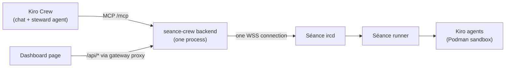

# Design Document

## Overview

Three documents and one test. They describe the app as built, so they are written after the other four specs are implemented. The test keeps them honest.

| File | Purpose |
| --- | --- |
| `docs/DEMO.md` | Scripted 60 to 90 second scenario with exact prompts and expected screen text. |
| `docs/WRITEUP.md` | Judge-facing write-up: features, architecture, security, how Kiro built it. |
| `README.md` | Install, trust, configure, develop, security, screenshots list. |
| `backend/test/docs.test.ts` | Docs consistency test (headings, prompts, links, tool names, API paths, forbidden word, secrets). |

## Architecture

The documents are static files under the repository root and `docs/`, checked by one test. They are produced after the code, in the order given by the tasks.

### Process

The documents are drafted from the finished code and specs. Each claim is traced to a requirement or test ID in a hidden HTML comment or review note during writing, and the comments are removed before the final version. Screenshots are taken manually from `kirocrew app dev seance-crew` and are not generated by code.

## Components and Interfaces

### DEMO.md structure

1. **What you will see** (two sentences) and total time.
2. **Prerequisites** (checklist, see Requirement 1.6).
3. **Script** as a table: step, time, who, action (exact prompt or command), expected screen text.
4. **Recovery** (invite refused, agent stays starting, no needs-op item, reset).
5. **Cleanup** (`exorcise`, leave the channel, nothing to commit).

Script, with target timings:

| # | Time | Where | Action | Expected screen text |
| --- | --- | --- | --- | --- |
| 1 | 0:00 | Crew chat | Type: `summon coder into #crew-live and ask it to fix the failing test` | Steward calls `summon`; reply contains `coder` and `#crew-live`; tool result `ready: true` or "still starting" |
| 2 | 0:10 | Dashboard | Open `/apps/seance-crew` | Channel card `#crew-live`, agent row `coder`, status banner `registered`; log line `worktree ready: <dir> @ <sha>` |
| 3 | 0:20 | Crew chat | Steward asks to grant `+v` (confirm yes), then prompts `coder` via `say` | Agent row shows `+v`; log shows the prompt |
| 4 | 0:30 | Dashboard | Wait for the inbox | Needs-op item: `coder denied <action>: needs-op` |
| 5 | 0:40 | Dashboard | Click "Grant op", then "Confirm" in the dialog | Dialog text `Grant +o to coder in #crew-live?`; after confirm, agent row `+o`, item disappears |
| 6 | 0:55 | Dashboard | Watch the card | Commit row `coder committed <sha> (<n> file(s))`; credits `<X.XX>` rising |
| 7 | 1:10 | Crew chat | Type: `exorcise coder` | Steward asks to confirm; after yes: `session closed, worktree reset to <sha>`, `<N> file(s) reverted · <X.XX> credits used` |
| 8 | 1:20 | Dashboard | Look at the card | Agent row gone, final credits shown, summary card unchanged ("No summary yet" or the last daily summary) |

The exact strings are copied from the implemented UI and ChanServ notice formats (`.kiro/steering/irc-seance.md`). Step 4 depends on the crew nick being `+o` in the channel, because the server sends `ops:` notices only to human operators; this is called out in the prerequisites.

### WRITEUP.md structure

Summary, Features, Architecture, Security model, How Kiro built it, Try it, Links, as in Requirement 2.1. Architecture diagram:

Text version: "Crew calls MCP tools or the dashboard calls the JSON API; both reach one backend process; the backend holds one WebSocket to the Séance ircd; the Séance runner starts Kiro agents in a Podman sandbox per channel worktree."

"How Kiro built it" lists: the five specs under `.kiro/specs/`, each with requirements (EARS), design and tasks; the steering files and what each one pinned down (for example `kirocrew.md` holds facts verified on a live gateway); the hooks `guard-shell` (blocks destructive shell commands) and `verify-after-task` (typecheck and tests after each task). It points to the Séance repository for the system this app steers.

### README structure

Description; Install; Trust; Enable; Configure (table); Use (MCP tools in Crew chat, dashboard); Develop; Security (including the accepted-risk sentence); Screenshots (placeholder list); Links; License.

## Data Models

No persistent data. The documents are static Markdown files, and the docs test reads them together with `app.json` and the tool catalog.

## Error Handling

A document claim that no longer matches the code fails `docs.test.ts` instead of being fixed by hand later. The demo document has its own recovery section for run-time problems (refused invite, agent still starting, no needs-op item).

## Correctness Properties

### Property 1: Documents match the code

Every MCP tool name and `/api/*` path mentioned in the documents exists in the tool catalog or in `permissions.api`.

**Validates: Requirements 2.7, 4.2**

### Property 2: Demo prompts are verbatim

Both demo chat prompts appear verbatim in `docs/DEMO.md`.

**Validates: Requirements 1.2, 1.4, 4.1**

### Property 3: No secrets or forbidden words in documents

No document contains a secret-looking string or the forbidden trademark word.

**Validates: Requirements 1.8, 4.1**

## Testing Strategy

See the docs test below.

### Docs test

`docs.test.ts` reads the three documents and asserts:

- required headings exist in each;
- the two chat prompts appear verbatim in `DEMO.md`;
- the six screenshot filenames appear in the README;
- the Séance repository URL appears in `WRITEUP.md`;
- every tool name in a backtick list in `WRITEUP.md` is in the tool catalog (imported from `src/mcp/tools.ts`), and every `/api/...` path mentioned is in `app.json` `permissions.api`;
- relative Markdown links resolve to files, except paths under `docs/img/` listed as placeholders;
- no string matching secret patterns and no forbidden word (the lint script's check is reused).
