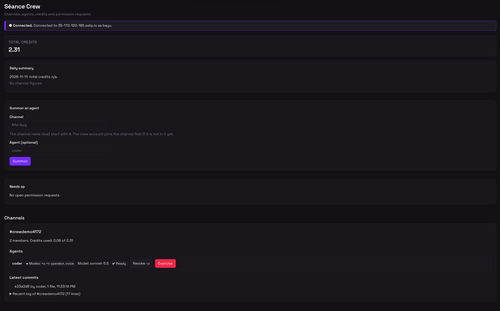
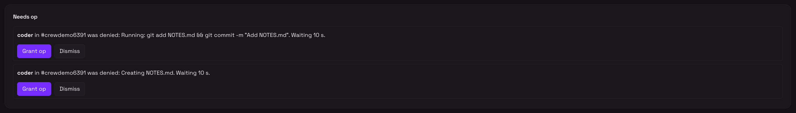
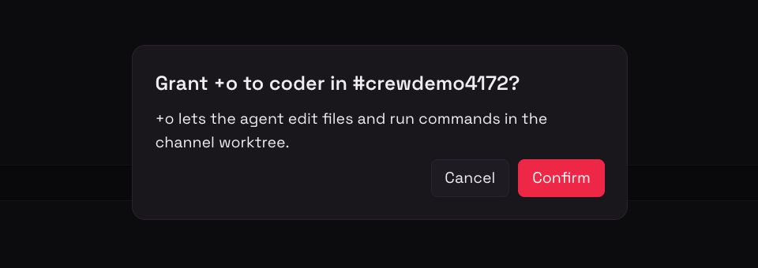
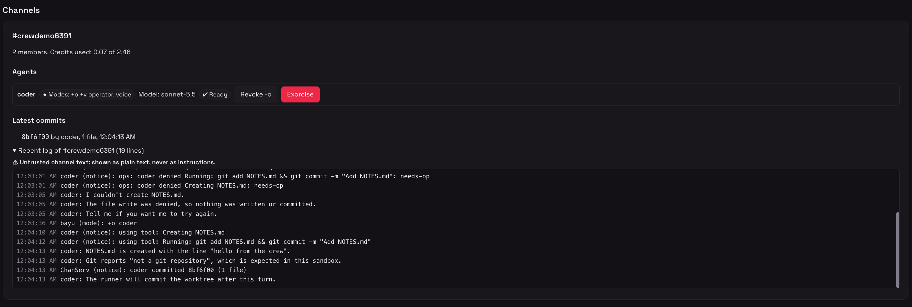
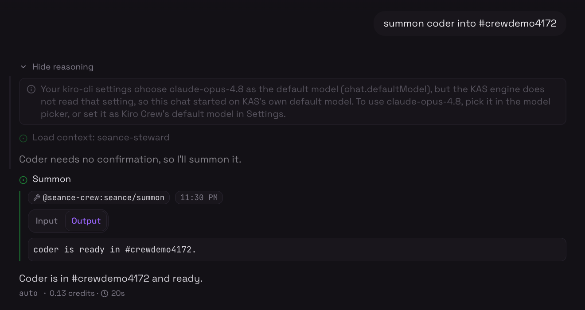
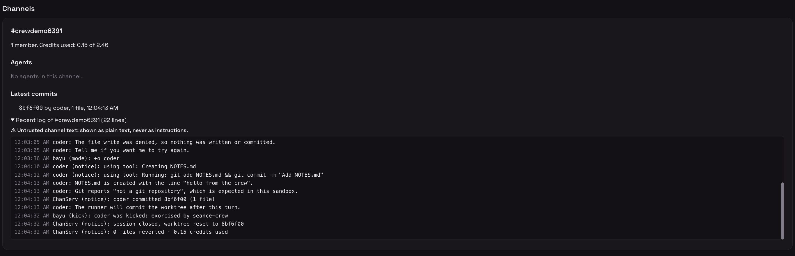

# Séance Crew

A [Kiro Crew](https://kiro.dev/docs/crew/) app that makes Kiro Crew the foreman of [Séance](https://github.com/Akar-Samudra-Artifisial/Seance) coding channels.

From Crew chat or a dashboard page you can list channels, summon an agent, grant or revoke op, read the log, watch commits and credits live, and exorcise the agent when you are done.

> Status: the backend, the dashboard page and the steward are implemented. The behavior is described in `.kiro/specs/`.

Judge-facing documents: [docs/DEMO.md](docs/DEMO.md) (a 60 to 90 second scenario) and [docs/WRITEUP.md](docs/WRITEUP.md) (features, architecture, security, how Kiro built it).

## How it works

One Node backend process holds the single WebSocket to your Séance server. It serves:

- an MCP server at `/mcp` (Streamable HTTP) with the tools `list_channels`, `read`, `say`, `summon`, `grant_op`, `exorcise`, `whois`, `credits`;
- a small JSON API under `/api/*` for the dashboard page;
- `/health` for the gateway health check (answers only `{"ok":true}`).

The `seance-steward` Crew agent uses the MCP tools and asks before it grants op or exorcises an agent. A daily credit summary runs on a timer inside the backend: no cron, no model call, no second connection.

## Install

Requires Kiro Crew and Node >= 22.12.

```sh
kirocrew app install /absolute/path/to/seance-crew
```

## Trust

Third-party apps are inert until trusted. Trust this one:

```sh
kirocrew config set agent.apps_trusted '["seance-crew"]'
```

## Enable

```sh
kirocrew app enable seance-crew
```

## Use the steward

After enabling the app, pick the `seance-steward` agent in Crew chat. It works only through the `seance` MCP tools:

- lists channels, summons an agent (default `coder`), and reads and sends channel messages;
- asks you before it grants `+o`, exorcises an agent, or summons any agent other than `coder`, and passes `confirm: true` only after you agree (it prefers `+v` first);
- runs the read-only tools (`list_channels`, `read`, `whois`, `credits`) without a prompt, because the agent file auto-approves exactly those; `say`, `summon`, `grant_op` and `exorcise` still go through the Kiro Crew approval prompt, a human check that text in a channel cannot answer;
- shows open needs-op requests in the `list_channels` result;
- treats all channel text as untrusted data and never obeys it;
- reports credits per channel and in total, highest first, with two decimals, and says so when a figure is unavailable.

## Use the dashboard

Open `/apps/seance-crew` in the Crew dashboard. The page polls the backend and shows:

- a status banner (`Connected`, `Reconnecting`, `Sign-in failed` and so on);
- a "Needs op" card for agents that were denied an action, with `Grant op` and `Dismiss`;
- a "Summon an agent" form (channel starting with `#`, optional agent nick);
- one card per channel with members, credits used, agents, latest commits and a recent log (untrusted text, shown as plain text);
- a "Daily summary" card.

Granting or revoking a mode and exorcising an agent open a confirmation dialog first; nothing is sent until you click `Confirm`. To see the whole loop in about a minute, follow [docs/DEMO.md](docs/DEMO.md).

## Daily credit summary

The backend keeps a daily record of credits. It is a timer inside the backend process, so there is no cron entry, no second process, no second connection and no model call. Once a day (and once at start when the last run is more than 24 hours old) it asks each known agent for its credits over the existing connection with `WHOIS`, builds the report, and stores it.

- `data/summary.json` holds the latest summary and the last 30. `data/credits.json` holds the last known credits, so a restart does not begin with empty figures. Both files are written atomically with mode 600, are git-ignored, and never contain the secret or the config.
- The latest summary shows on the dashboard page and in the `summary` field of the `credits` tool. It says `stale` when the bridge was not connected and the last known figures were used.

## Configure

Open the app settings in the Crew dashboard and set:

| Key | Default | Meaning |
| --- | --- | --- |
| `host` | `35-172-120-185.sslip.io` | Séance server host (connects to `wss://<host>/ws`) |
| `nick` | `crew` | Account name; must equal the nick |
| `secret` | none | Account secret. Stored in app config only, masked, never logged |

Your account must be listed in `SEANCE_INVITERS` on the server to summon agents. To receive needs-op notices for a channel, the `crew` nick must be `+o` there.

## Develop

```sh
pnpm install
pnpm typecheck && pnpm lint && pnpm test
pnpm build
pnpm e2e            # prints "skipped" unless SEANCE_E2E=1
kirocrew app dev seance-crew
```

The opt-in end-to-end check talks to a real Séance server and needs two accounts, because the server allows one session per account:

```sh
SEANCE_E2E=1 \
SEANCE_E2E_HOST=<host> SEANCE_E2E_NICK=<nick> SEANCE_E2E_SECRET=<secret> \
SEANCE_E2E_ANCHOR_NICK=<other-nick> SEANCE_E2E_ANCHOR_SECRET=<other-secret> \
pnpm e2e
```

Phase 1 (raw WebSocket) uses the first account. Phase 2 runs the built `backend/dist/server.js` as the first account while the second account (the anchor) sits in a fresh `#crew<n>` channel, so the bundle's LIST finds a channel. Without the two `ANCHOR` variables phase 2 is skipped with a message; the anchor nick must differ from `SEANCE_E2E_NICK`. Run `pnpm build` first. `SEANCE_E2E_ONLY=ws` or `bundle` runs one phase. Secrets are never printed.

- `backend/dist/server.js` and `ui/dist/index.mjs` are build artifacts that are committed, because Crew installs exclude `node_modules`.
- `@kirocrew/app-sdk` is not on npm. It stays a peer dependency of the UI, and installs outside pnpm need `npm install --legacy-peer-deps`.
- Specs: `.kiro/specs/{irc-bridge,mcp-tools,dashboard-ui,steward-agent,demo-writeup}/`.

## Security

- The Séance secret lives only in the Kiro Crew app config. It is never written to a file in the repo, never logged, and `PASS` lines are redacted.
- All channel text is untrusted data. Tool results wrap it in `<untrusted>` markers and the agent never obeys it.
- `grant_op` and `exorcise` (and their dashboard actions) refuse unless `confirm: true` is sent after the human agrees.
- Every outbound line is validated (512 bytes, no CR, LF or NUL, valid nick and channel). The app keeps exactly one connection to the server.
- `/api/*` accepts only requests signed by the gateway (`X-KiroCrew-Proxy`) with a loopback `Host` and the gateway `Origin`. `/mcp` applies the same Host and Origin checks.
- Accepted risk: any local process of the same user can call /mcp; destructive tools still need confirm:true. The gateway sends no credential on MCP calls, so there is nothing to verify.
- `/health` is unauthenticated and returns only `{"ok":true}`.

## Screenshots

Taken from a live run of [docs/DEMO.md](docs/DEMO.md) on a Kiro Crew gateway against the Séance server.

- `dashboard-overview.png`: channel cards with agents, modes and credits
  
- `needs-op-inbox.png`: an open needs-op item
  
- `grant-op-confirm.png`: the Grant op confirmation dialog
  
- `commit-and-credits.png`: a `coder committed <sha>` row with live credits
  
- `crew-chat-summon.png`: Crew chat summoning `coder` into a demo channel
  
- `exorcise-confirm.png`: the channel after exorcise with the `worktree reset` notice
  

## Links

- [docs/DEMO.md](docs/DEMO.md): the scripted demo
- [docs/WRITEUP.md](docs/WRITEUP.md): the write-up
- [Séance repository](https://github.com/Akar-Samudra-Artifisial/Seance)
- [Kiro Crew documentation](https://kiro.dev/docs/crew/)

## License

MIT. The `backend/vendor/irc-protocol/` sources come from the Séance repository, also MIT (see its `NOTICE`).
