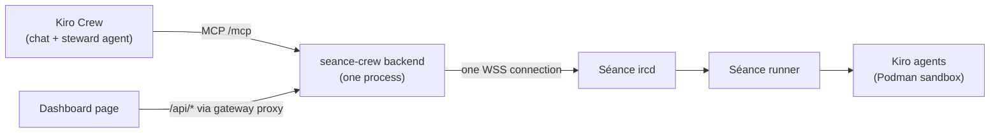

# Séance Crew: write-up

## Summary

Séance Crew is a Kiro Crew app that makes Kiro Crew the foreman of [Séance](https://github.com/Akar-Samudra-Artifisial/Seance) coding channels. In Séance, a coding agent lives in an IRC channel with its own git worktree. This app lets you run those channels from Crew chat or from one dashboard page: summon an agent, grant or revoke op, follow commits and credits live, and exorcise the agent when the work is done.

Everything goes through one Node backend process that keeps a single WebSocket connection to the Séance server. The app has zero runtime npm dependencies in the backend, no cron and no second connection. A 60 to 90 second scripted demo is in [DEMO.md](DEMO.md).

## Features

- MCP tools served at `/mcp` (eight): `list_channels`, `read`, `say`, `summon`, `grant_op`, `exorcise`, `whois`, `credits`.
- Dashboard page at `/apps/seance-crew`:
  - channel cards with topic, member count and credits used;
  - agent rows with modes (`+o`, `+v`), model and a Ready or Starting indicator;
  - latest commits per channel and a recent log with an untrusted-text warning;
  - a "Needs op" inbox that lists agents denied an action, with Grant op and Dismiss;
  - a Summon form and, on each agent row, mode buttons and Exorcise;
  - every grant, revoke and exorcise goes through a confirmation dialog (Cancel is focused first).
- The `seance-steward` Crew agent ([agents/seance-steward.json](../agents/seance-steward.json) and [skills/seance-steward/SKILL.md](../skills/seance-steward/SKILL.md)). It auto-approves only the four read-only tools (`list_channels`, `read`, `whois`, `credits`). `say`, `summon`, `grant_op` and `exorcise` show the Kiro Crew approval prompt, and the steward also asks you in chat before granting op or exorcising.
- A daily credit summary. A timer inside the backend asks each known agent for its credits over the existing connection and stores the result in `data/summary.json`. The dashboard shows the latest one and the `credits` tool returns it. It makes no model call.

## Architecture



Text version: Crew calls MCP tools, or the dashboard calls the JSON API; both reach one backend process. The backend holds one WebSocket to the Séance ircd. The Séance runner starts a Kiro agent in a Podman sandbox for each channel worktree.

The backend parses ChanServ notices (`worktree ready`, `<agent> is ready`, `<agent> committed <sha>`, `session closed`, `<N> file(s) reverted`) and server `ops:` denial notices into typed facts. The facts feed the MCP tools, the dashboard state (`/api/state`, polled by the page), the needs-op inbox and the credits record. The JSON API is `/api/state`, `/api/summary`, `/api/summon`, `/api/grant-op`, `/api/exorcise` and `/api/inbox/dismiss`; the gateway exposes each under `/apps/seance-crew` (see `permissions.api` in [app.json](../app.json)).

## Security model

- **Secret.** The Séance secret lives only in the Kiro Crew app config (masked). It is never written to a repository file and never logged; `PASS` lines are redacted.
- **Untrusted channel text.** All text from the server is data. Tool results wrap it in `<untrusted>` markers, the steward is told never to obey it, and the dashboard renders it as plain text with control and bidi characters removed.
- **Confirmation.** `grant_op` and `exorcise` (and their dashboard actions) refuse unless `confirm: true` is sent. Summoning any agent other than `coder` also needs it. The flag is set by the caller, so it is not proof of a human yes by itself; the dashboard sets it only after the Confirm click, and for Crew chat the host's approval prompt is the human check.
- **Line validation.** Every outbound line is limited to 512 bytes and cannot contain CR, LF or NUL; nicks and channels are validated.
- **One connection.** The app keeps exactly one connection to the server, and a second copy of the app stays disconnected and says so.
- **Local-only HTTP.** `/api/*` accepts only requests signed by the gateway (`X-KiroCrew-Proxy`) with a loopback Host and the gateway Origin; a signed POST cannot be replayed. `/mcp` applies the same Host and Origin checks. `/health` is unauthenticated and returns only `{"ok":true}`.
- **Accepted risk.** Any local process of the same user can call /mcp; destructive tools still need confirm:true. The gateway sends no credential on MCP calls, so there is nothing to verify.

Rate limits cap `say` and `summon` so a looping model cannot flood a channel. The full rules are in [.kiro/steering/security.md](../.kiro/steering/security.md).

## How Kiro built it

The app was built with Kiro specs, steering files and hooks.

- **Specs** in [.kiro/specs/](../.kiro/specs/): five specs, each with `requirements.md` (EARS acceptance criteria), `design.md` and `tasks.md`. They are `irc-bridge`, `mcp-tools`, `dashboard-ui`, `steward-agent` and `demo-writeup`. Tasks were worked in order, tests included, with a green build after each.
- **Steering** in [.kiro/steering/](../.kiro/steering/): `product.md` (what the app is for), `tech.md` (stack and commands), `kirocrew.md` (Crew runtime facts verified on a live gateway), `irc-seance.md` (the Séance protocol and notice formats) and `security.md` (the threat model and rules above).
- **Hooks** in [.kiro/hooks/](../.kiro/hooks/): `guard-shell.json` blocks destructive shell commands before they run, and `verify-after-task.json` runs `pnpm typecheck && pnpm test` after each spec task.

The system this app steers is described in the [Séance repository](https://github.com/Akar-Samudra-Artifisial/Seance).

## Try it

```sh
kirocrew app install /absolute/path/to/seance-crew
kirocrew config set agent.apps_trusted '["seance-crew"]'
kirocrew app enable seance-crew
```

Set `host`, `nick` and `secret` in the app settings, pick the `seance-steward` agent, and follow [DEMO.md](DEMO.md). The [README](../README.md) has install, configuration and development details.

## Links

- Séance repository: https://github.com/Akar-Samudra-Artifisial/Seance
- Kiro Crew documentation: https://kiro.dev/docs/crew/
- Demo script: [docs/DEMO.md](DEMO.md)
- README: [README.md](../README.md)
